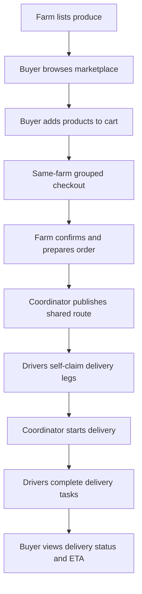

# FarmLink Direct 🌱

**A Collective Farm-to-Hospitality Purchasing and Shared Delivery Platform**

[**Live Demo**](https://guanyu-lu.github.io/FarmLink_Direct/) | [**GitHub Repository**](https://github.com/Guanyu-Lu/FarmLink_Direct)

**Scan to Explore Demo:**  


> **CP2405 Assessment 2 · Group PA-03**  
> **Status:** Interactive academic MVP (not a live commercial service)  
> **Business concept:** Singapore-based B2B platform | **Initial pilot:** Kuala Lumpur, Malaysia | **Currency:** SGD

## Overview

FarmLink Direct explores a more coordinated way for restaurants, hotels and cafés to source fresh produce directly from farms. Conventional purchasing can involve multiple intermediaries, fragmented orders and separate transport arrangements. Small hospitality buyers may struggle to meet the order volumes needed for farm-direct delivery, while farms face uncertain demand.

Our interactive prototype connects **hospitality buyers, farm suppliers, drivers and a Platform Delivery Coordinator**. It brings product discovery, collective demand, grouped checkout, farm confirmation, shared delivery and order tracking into one demonstration workflow.

The website is an HTML-based minimum viable product (MVP) deployed through GitHub Pages. It uses seeded example records to illustrate the proposed Kuala Lumpur pilot rather than actual commercial transactions.

## Main Features

| Role | Available functionality |
| --- | --- |
| **Buyer (Restaurant / Hotel / Café)** | Browse produce and farm profiles; search, filter and sort products; view group-order progress; add products to cart; place same-farm grouped orders; review transparent produce and delivery costs; track order status, driver activity and ETA. |
| **Farm Supplier** | Switch between demo farm profiles; create, edit and remove produce listings; manage stock, prices, group targets and delivery days; confirm or reject grouped orders; mark orders ready for pickup. |
| **Platform Delivery Coordinator** | Review ready-for-pickup orders; choose orders with matching delivery areas and days; manually publish shared routes; monitor routes, driver claims, delivery progress and illustrative payout information. |
| **Driver** | Switch between demo drivers; browse open delivery legs; claim or release tasks; view proposed payouts; inspect pickup and drop-off locations on a virtual map; complete delivery legs. |

### What Makes the Model Different?

- **Collective demand:** Individual hospitality orders contribute towards visible group-order targets, helping farms understand combined purchasing demand.
- **Same-farm grouped checkout:** Multiple items bought by one buyer from the same farm for the same delivery day become one farm batch order, instead of separate product-level orders.
- **Shared delivery:** Confirmed orders with compatible delivery days and areas can be grouped into one shared route.
- **Driver self-claim:** Published routes contain three independently claimable delivery legs: **farm pickup**, **hub transfer**, and **final-mile delivery**.
- **Transparent tracking:** Buyers can review order status, estimated driver positions, delivery activity and ETA ranges on a virtual logistics map.

**Demo vs. planned automation:** The long-term concept uses automatic compatible-order consolidation. The current MVP deliberately requires the coordinator to manually create and publish a route so that the workflow can be demonstrated step by step.

## Workflow



## How to Explore the Demo

**Website:** https://guanyu-lu.github.io/FarmLink_Direct/

No signup or configuration is required. The homepage contains four role entry points, and the navigation includes a **Switch role** button.

1. **Reset the demo if needed.** Select **Reset data** and confirm to restore the original products, orders, carts and routes.
2. **Explore the Buyer Dashboard.** Choose a sample buyer and browse the marketplace. Search by product or farm, filter by category or sort results.
3. **Place an order.** For a grouped-order example, add **Tomatoes** and **Lettuce** from **Green Valley Farm** (both listed for Monday delivery). View the cart, check delivery costs, complete the checkout form and select **Place order**.
4. **Confirm the order as a farm.** Switch to **Farm**, select **Green Valley Farm**, open **Incoming orders**, then **Confirm** the new order and **Mark ready** for pickup.
5. **Publish a delivery route.** Switch to **Platform Delivery Coordinator**. In **Ready order pool**, select orders sharing the **same delivery area and delivery day** and use **Create route** / **Publish shared route**. The prototype creates three delivery legs.
6. **Claim the legs as a driver.** Switch to **Driver**, examine **Available tasks** and claim each open leg. You can change the selected demo driver to demonstrate the separate claims.
7. **Start the route.** Return to the coordinator's **Published routes** tab. All three delivery legs must have been claimed before **Start delivery** is available.
8. **Complete the delivery.** In **My claimed tasks**, each driver can mark their own leg complete once the route is in transit. Return to the buyer's **My orders** page to check the updated order status and virtual tracking information.

The website also starts with sample orders, including ready-for-pickup orders, allowing the delivery workflow to be explored without creating every order manually.

## Delivery Pricing and Platform Revenue

The prototype applies an illustrative **distance-and-weight delivery fee** that is displayed separately from the produce cost.

| Component | Demo rule |
| --- | --- |
| Base delivery fee | **SGD 4.50**, includes the first **10 km** and **10 kg** |
| Additional distance | **SGD 0.25 / km** beyond 10 km |
| Additional weight | **SGD 0.05 / kg** beyond 10 kg |
| Driver / logistics payout | **80%** of delivery charges |
| FarmLink Direct commission | **20%** of delivery charges |
| Separate buyer platform service fee | **SGD 0.00** |

**Example:** For an illustrative delivery of **25 kg over 18 km**, the fee is **SGD 7.25**: SGD 4.50 base charge + (8 × SGD 0.25) additional distance + (15 × SGD 0.05) additional weight.

The 20% platform commission is taken **from the delivery charge**, not added on top of the buyer's fee. For shared routes, the driver's 80% payout pool is divided among the three delivery legs according to their estimated distances. Produce sales are conceptually passed to farms rather than counted as platform commission revenue.

## Technology Stack

| Technology | Purpose |
| --- | --- |
| **HTML5** | Page structure, role dashboards and forms |
| **CSS3** | Layout, responsive styling and visual components |
| **Vanilla JavaScript** | Marketplace, cart, orders, route management and role interactions |
| **SVG** | Illustrated virtual logistics map |
| **Browser localStorage** | Saves the demonstration state on the current browser/device |
| **GitHub Pages** | Static website hosting |

### Repository Structure

```text
FarmLink_Direct/
├── index.html     # Entire frontend: HTML, CSS, JavaScript and embedded image asset
└── README.md      # Project description and demo guide
```

The app is a **self-contained static frontend**: it has no database server, backend API, account authentication, live mapping service or real payment integration. Sample users are selectable profiles for demonstration, not secure real-world accounts.

## Run Locally

Clone the repository:

```bash
git clone https://github.com/Guanyu-Lu/FarmLink_Direct.git
cd FarmLink_Direct
```

You can open `index.html` directly in a modern web browser. Alternatively, start a local HTTP server:

```bash
python -m http.server 8000
```

Open **http://localhost:8000/** in your browser. If your system uses `python3`, run `python3 -m http.server 8000` instead.

**No Node.js packages, build process or API keys are required.**

## Demo Data and Reset

The prototype starts with sample produce, farms, hospitality businesses, drivers and orders from the Kuala Lumpur scenario. Adding to a cart, managing farm stock, publishing routes and updating delivery tasks change the local demonstration state.

- The application stores its working state in **browser localStorage**.
- Changes may survive page refreshes in the same browser.
- State is **not shared across browsers, devices or visitors**.
- To restore the starting dataset, use **Reset data** at the top of the webpage.

## MVP Scope and Limitations

**Included:** fresh fruits and vegetables, a Kuala Lumpur pilot scenario, group-order progress, same-farm checkout, farm confirmation, coordinator-triggered shared routes, three-leg driver self-claim, virtual route maps, estimated tracking, delivery-price calculation and the 80%/20% payout illustration.

**Outside the current MVP:** real GPS, real dispatch, real payment settlement, server-based multi-user data, automatic event-driven route publication, native mobile apps, AI demand forecasting, trust ratings, advanced inventory integrations, cold-chain operations and multi-city deployments.

> **Prototype disclaimer:** Product data, orders, buyer and farm identities, delivery locations, route positions, ETAs, savings, fees and payouts are representative demo data. Using the prototype does **not** place a real order, transfer money or dispatch a real driver.

## Initial Pilot and Future Plans

The accompanying business proposal describes a controlled **Kuala Lumpur pilot** with initial targets of **two farms**, **five hospitality buyers**, **at least two same-farm grouped batch orders**, **one shared route**, and **three completed driver delivery legs**. These are **validation targets, not achieved business results**.

Future work includes stakeholder testing, real multi-user data storage, secure accounts, payment and delivery integrations, automatic route consolidation, real-time tracking and eventually wider regional coverage.

## Project Team

Developed for **CP2405 Assessment 2 — Group PA-03**.

- Junjie Chu
- Yihan Dang
- Guanyu Lu
- Xiangming Luo
- Zaikun Zheng

The repository accompanies the *FarmLink Direct — A Collective Farm-to-Hospitality Purchasing and Shared Delivery Platform* business proposal.

---

**Project status:** Working interactive academic MVP, currently pre-revenue. The prototype demonstrates a proposed business workflow; it does not represent confirmed commercial customer adoption or operational partnerships.
